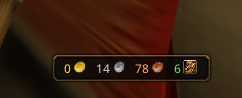

# CoinPouch 🪙

**Your gold and bag space at a glance.**

CoinPouch is a lightweight, movable World of Warcraft addon that keeps your character's money and available bag space visible without opening your bags. Compatible with both **WoW Retail** and **WoW Forever**.

**Author:** BrainByteZ  
**Current project version:** 0.9.0


## Features

- **Money at a glance:** Displays gold, silver, and copper with familiar in-game coin icons.
- **Free bag slots:** Shows the number of available slots across your backpack and equipped bags.
- **Color-coded bag space:** Green when more than 25% is free, yellow from 10% through 25%, and red below 10%.
- **Click to open bags:** Left-click the widget to toggle all bags.
- **Move it anywhere:** Right-drag the widget to reposition it. The position is saved between sessions, and the widget automatically stays within screen boundaries.
- **Adjustable scale:** Resize the widget from 50% to 200% to suit your preferences. The selected scale is saved between sessions.
- **In-game settings:** Customize the widget through WoW's built-in AddOns settings page.
- **Easy reset options:** Restore the default scale or position independently with dedicated buttons.
- **Shift-hover tooltip:** Hold **Shift** while hovering to see the addon version, free/total bag slots, free-space percentage, and controls.
- **Responsive size:** The widget adjusts its width to fit the displayed values.
- **Warcraft-inspired appearance:** Dark background, gold-toned border, hover highlight, and a custom addon icon.
- **No dependencies.**

## Screenshot



*CoinPouch displaying your gold, silver, copper, and available bag slots.*

## Controls

| Action | Result |
| --- | --- |
| Left-click | Toggle all bags |
| Right-drag | Move the widget |
| Shift + hover | Show detailed tooltip and controls |
| `/coinpouch reset` | Reset the widget to its default position |

## Installation

1. Download or copy the addon files into your WoW Forever `Interface/AddOns/CoinPouch/` directory.
2. Make sure `CoinPouch.toc`, `CoinPouch.lua`, and `Media/CoinPouch.tga` are present.
3. Start or restart the game and enable **CoinPouch** in the AddOns list.

The widget appears near the center of the screen by default. Right-drag it to your preferred position.

> **Compatibility:** Developed and tested for WoW Forever (interface `16001`). Compatibility with other WoW clients is not guaranteed.

## Configuration

CoinPouch works out of the box. Its position is stored using WoW's `CoinPouchDB` SavedVariables table.

To restore the default position, enter:

```text
/coinpouch reset
```

## Development

The Git repository is kept **outside the WoW installation**. Only runtime files should be deployed into the game's AddOns directory.

```text
CoinPouch/
├── Assets/                 # Original artwork; not required in game
├── Media/
│   └── CoinPouch.tga      # In-game addon icon
├── Screenshots/
│   └── Screenshot.png     # In-game screenshot
├── Scripts/
│   ├── deploy.ps1         # Deployment script
│   └── deploy.local.ps1   # Local paths (ignored by Git)
├── CoinPouch.lua
├── CoinPouchSettings.lua
├── CoinPouch.toc
└── README.md
```

### Deploy from VS Code

The local development setup uses VS Code build tasks and PowerShell to deploy CoinPouch to **WoW Forever**, **WoW Retail**, or both.

1. Configure your local WoW AddOns directories in `Scripts/deploy.local.ps1`:

   ```powershell
   $AddonPaths = @{
       Forever = "C:\Path\To\WoW\_forever_\Interface\AddOns"
       Retail  = "C:\Path\To\WoW\_retail_\Interface\AddOns"
   }
   ```

2. In VS Code, press **Ctrl+Shift+B** to deploy to **WoW Forever** (the default build task).

3. To deploy to another client, select **Terminal → Run Task** and choose:
   - **Deploy CoinPouch (Forever)** — Deploy to WoW Forever.
   - **Deploy CoinPouch (Retail)** — Deploy to WoW Retail.
   - **Deploy CoinPouch (All)** — Deploy to both clients.

4. In the target game client, type `/reload` to test Lua changes.

Alternatively, run the deployment script directly from PowerShell:

```powershell
.\Scripts\deploy.ps1 -Client Forever
.\Scripts\deploy.ps1 -Client Retail
.\Scripts\deploy.ps1 -Client All
```

The deployment script copies only the required addon files, including `LICENSE`. The `Assets/` directory, local configuration, development scripts, and Git metadata stay out of the game installations.

> **Note:** `Scripts/deploy.local.ps1` must be listed in `.gitignore` because it contains machine-specific installation paths.

## License

CoinPouch is free software licensed under the **GNU General Public License version 3.0 only (GPL-3.0-only)**. You may use, modify, and redistribute the addon under the terms of this license. See [LICENSE](LICENSE) for the full license text.

The GPL applies to the CoinPouch code and original project assets owned by the author; third-party World of Warcraft artwork, icons, and trademarks remain the property of their respective owners.

---

*CoinPouch is a community-made addon and is not affiliated with or endorsed by Blizzard Entertainment.*
